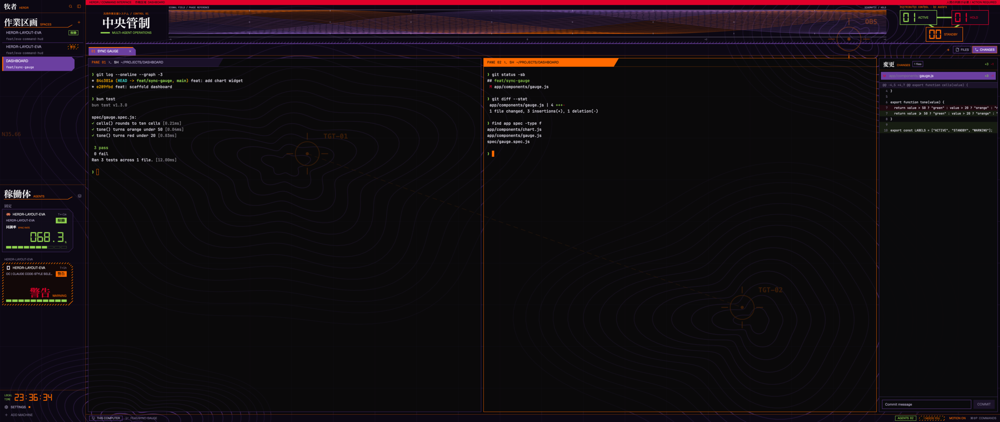
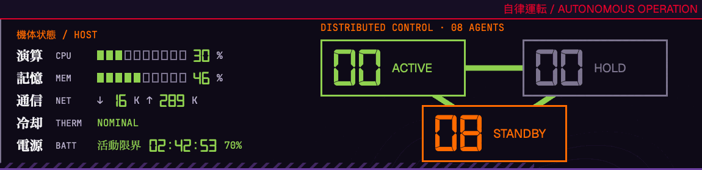

# herdr-layout-eva

A late-90s command-center HUD layout for [herdr-app](https://herdr.dev). It has purple cut-corner plates, orange for whatever is selected, heavy Mincho kanji titles and large seven-segment readouts. A command deck above the terminals holds live agent counts and an orange/purple signal field; click the field to hold it still. Beside it, 機体状態 HOST reads out the Mac itself: CPU, memory, network, thermal state and power. Its top strip is a warning light: a thin red rule normally, solid red when an agent needs you. Red is kept for warnings only. Terminals are about 80% opaque, so the topo map shows faintly behind them. Agents show up as HUD cards with a **SYNC RATE**, the percent of their context window still free. Claude Code cards also show 圧縮, how many times the session has compacted, 記録, its transcript size, and the session's Claude Code version, orange when the installed `claude` is newer and the session needs a restart to pick it up. A new agent opens with a full-window 作戦開始 card. A blocked agent turns into a blinking hazard frame. Notifications come up with a kanji plate: 警告 when an agent needs you, 通報 when one finished.





All art is original vector work. It recreates a mood (colors, type, shapes), not any show's logos, characters or screenshots.

## What's inside

- `layouts/eva.json`: the layout, with `layouts/eva.png` as its preview in Settings → Look.
- `themes/eva.json`: the theme. Near-black terminals with purple, orange and green ANSI colors. Herdr's own palette, picker and menus pick it up too.
- `mods/`: the ten mods the layout draws with. Eight are cloned from Herdr's shipped mods, with behavior unchanged and only the look replaced; `eva-launch` and `eva-toast` are new.
  - `eva-chrome`: the command deck with its agent counts, native animated signal field (`command.js`) and 機体状態 HOST panel (`machine.js`), sidebar brand row and local clock. It also holds `wallpaper.png`.
  - `eva-spaces`: 作業区画 SPACES, with branch, ahead/behind and a status label.
  - `eva-agents`: 稼働体 AGENTS cards, with the SYNC RATE gauge (`sync.js`). The readout uses the Digital-7 Mono font in `fonts/`, by Sizenko Alexander of [Style-7](http://www.styleseven.com), freeware for non-commercial use.
  - `eva-tabs`: the tab bar.
  - `eva-pane`: the slanted pane header.
  - `eva-status`: the status bar, with the agent count, NEEDS YOU and the MOTION toggle. MOTION off stills every animation: the signal field and the warning blink.
  - `eva-files`, `eva-changes`: the 資料 FILES and 変更 CHANGES panels.
  - `eva-launch`: the 作戦開始 card `eva-agents` opens over the window when a new agent starts. It shows for about 1.8 seconds, doesn't take the keyboard, and closes on click. MOTION off skips it.
  - `eva-toast`: notifications, picked by the layout's `"toast": "eva-toast"`. A cut-corner plate shows the level: 警告 (red, blinking) for errors and agents that need you, 注意 (red) for warnings, 完了 (green) for success, 通報 (purple) for everything else. Click one to run its action, such as going to the agent, and close it.

## Requirements

- herdr-app 0.1.15 or newer. `eva-toast` needs 0.1.15's layout `toast` field. The mods are clones of Herdr's shipped mods, so a later Herdr may need its changes merged in.
- macOS for the Mincho titles (Hiragino Mincho ProN). On other systems they fall back to another font.
- For SYNC RATE: `sqlite3` and `jq` on PATH (both ship with macOS).

## Install

Ask your coding agent:

```text
Install the EVA layout from https://github.com/Dylan0203/herdr-layout-eva by following the Install section of its RECIPE.md.
```

It copies the layout, theme and mods into `~/.config/herdr-app/` and switches to the layout. To go back, open the palette (`cmd-shift-p`) and pick "Layout: Herdr".

## Privacy

`eva-spaces` runs `git` in each space's folder and `hc machine ls`, as the shipped spaces list does.

For SYNC RATE, `eva-agents` does the following every 15 seconds for each local agent:

- It runs `pgrep`, `ps`, `lsof`, `grep`, `tail`, `sqlite3` (read-only) and `jq` to find the agent's session.
- **Claude Code:** it reads `~/.claude/sessions/<pid>.json` (including the session's version), the last few MB of that session's transcript under `~/.claude/projects/`, and `~/.claude/settings.json`. For 圧縮 and 記録 it takes the transcript's size and scans the bytes appended since the last poll for compaction markers. The first poll after Herdr starts greps each transcript once in full, which takes about 40 seconds for a 4.6 GB one. If that scan fails, the card shows `圧縮 --` instead of retrying every poll.
- **Codex:** it reads `~/.codex/state_*.sqlite` and the session's rollout file.
- **OpenCode:** it reads `~/.local/share/opencode/opencode.db` and `~/.cache/opencode/models.json`.
- It reads only token counts, session ids, compaction markers, file sizes and versions.
- Every 10 minutes, while a Claude Code agent is open, it runs `claude --version` in a login shell to find the installed version.

For 機体状態 HOST, the command deck runs `pmset`, `memory_pressure`, `sysctl`, `ps`, `route` and `netstat` every 5 seconds, in one shell call. It reads only totals: CPU percent, memory pressure, interface byte counters, thermal throttling and battery state.

Nothing reaches the network.

## Known limits

- 機体状態 HOST is macOS only and shows when the command deck is at least 1400 px wide. It shows thermal throttling, not °C: Apple Silicon has no temperature reading without `sudo`. On battery, the power row becomes a 活動限界 countdown from macOS's estimate, red under 20%. It reads 計測中 until macOS has an estimate, which can take a minute or two after unplugging.
- SYNC RATE for Claude Code measures against 1M tokens. For a smaller budget, set `autoCompactWindow` in `~/.claude/settings.json` (or per model under `modelSettings`); note that Claude Code then also auto-compacts at that size. A non-number such as `"auto"` counts as unset.
- SYNC RATE covers local Claude Code, Codex and OpenCode agents. Others, and agents on other machines, show `---.-`.
- A fresh OpenCode shows `---.-` until its first reply.
- Two OpenCode agents, or two fresh Codex agents, in the same folder show the same rate.
- `T+4m` on a card is the time since the agent's state last changed. On the first run every agent is stamped "now".
- Status labels show only while an agent is working, done or blocked. Idle agents read `待機` on cards and space rows.

## Developing

Edit in `~/.config/herdr-app/` (Herdr ignores edits behind symlinks), then copy back into this repo:

```sh
./scripts/export.sh   # refuses if the eva.js copies differ
bun install && bunx --bun vitest run
```

Every mod carries its own identical `eva.js` (colors and drawing helpers), because a mod can import only from its own folder. Change one, then copy it to all ten.

See [RECIPE.md](RECIPE.md) for the full spec: every color, size and shape, how each mod draws, and what tripped the build up.
