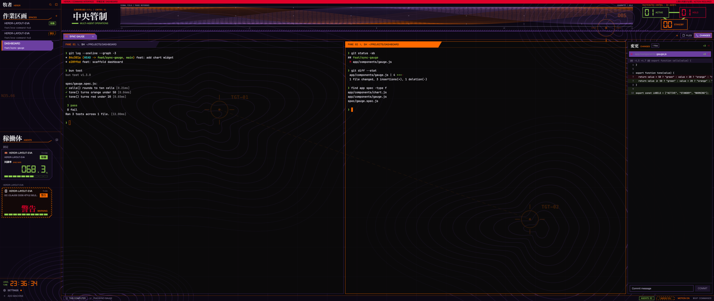

# EVA HUD

A herdr-app layout in the style of a late-90s command-center HUD. Near-black panels sit over a dim tactical topo map. Selected items are green plates with 45° cut corners and amber edges. A red command masthead holds large seven-segment agent counts, a three-part status diagram, and a moving red/cyan signal field. Section titles are heavy Mincho kanji with small orange English captions. Agents are HUD cards that show a SYNC RATE, the percent of their context window still free, on a ten-cell gauge. A blocked agent turns into an orange-and-black hazard frame with a blinking 警告 WARNING. All art is original vector work: no logos, characters or screenshots from any show.



## What you see

Palette (also in every mod's `eva.js`): ink `#0a0a0a`, deep `#101710`, slab `#172017`, frame green `#436c35`, amber `#f5b44b`, green `#8cbe55`, red `#ef492f`, white `#ecebd5`, text `#e6e5d3`, muted `#b0b69b`, dim `#78856b`. Titles use Hiragino Mincho ProN at weight 700. Readouts use Digital-7 Mono; codes use JetBrains Mono. Labels are weight-700 caps.

- **Window background:** `mods/eva-chrome/wallpaper.png`, a 3840×2160 PNG, fit `cover`. Base `#07060b`, a 160px purple grid at 32% opacity, four nested sets of 14 wobbly purple contour loops (30% to 89% opacity), three orange target reticles (`TGT-01`, `TGT-02`, `OBS`) joined by a dashed line, and orange `E139.xx` / `N35.xx` coordinate labels along the edges. Dividers between regions are 1px `#78994966`.
- **Command deck, 156px** (`eva-chrome` with `command: true`): a red identification strip, 中央管制 title, a 316px triangular status diagram with 50px Digital-7 counts for ACTIVE / HOLD / STANDBY. Show the registered total once above the diagram. Fit the signal field to the available body height, measured with `on_size_change`. Render it as 24 red and 24 cyan native vector strands. Move their clipped containers independently with native `left` loops (14 and 19 seconds, there and back). Label the field `SCHEMATIC`; it does not represent measured telemetry. Use a compact 248px diagram below 800px. Hide the title below 1150px and the signal field below 560px of deck width to preserve the diagram.
- **Sidebar, left, 304px,** background `#0b100af5` (96%). Give Spaces 40% and Agents 60% of the list area.
  - **Brand row, 46px** (`eva-chrome`): 牧者 in 23px Mincho red, then `HERDR` in 10px orange caps. Search and sidebar-toggle buttons are orange icons. The row has a `#f5b44b59` bottom border and drags the window.
  - **Spaces** (`eva-spaces`): a 56px title row holding 作業区画 (30px Mincho red), `SPACES` (10.5px orange), and an orange `+`. Under it is a 1.5px orange underline that kinks up at its right end.
    - Rows are 50px (worktree rows 30px). Line one is the name in 13px bold caps, then a status label. Line two is the repo/branch in 11px mono, with green `↑n` and red `↓n`, or `NO REPO`.
    - The active space is a green plate with 10px cuts on both right corners and a 4px orange bar on the left, with white text.
    - Other rows are transparent with a `#436c3566` bottom divider and muted text.
  - **Agents** (`eva-agents`): the title row reads 稼働体 `AGENTS`, 32px Mincho red, plus the sort button. Section headers (`WORKING 1`, `NEEDS YOU`, `PINNED`) are 10.5px bold caps in the status color. Each agent is a card the width of the list minus 22px, 8px apart, with 14px cuts on both right corners:
    - **Normal:** 112px, fill `#10160fcc`, 1px `#436c35aa` outline.
    - **Focused or working:** 152px, fill `#101710f0`, 1.5px green outline.
    - **Blocked:** 152px, hazard frame (orange `pattern_slash` stripes 5px wide every 12px on ink), a 5px inset `#120808` panel, and 警告 (34px Mincho red) plus `WARNING` (14px orange) in place of the number.
    - **Top line:** program icon and project name in 12px bold caps (white, or muted when idle), sub-agent fold, and elapsed time or hover pin. Put the tab name, optional remote machine, and status badge on a separate second line.
    - **Readout:** `SYNC RATE` (9.5px orange), the rate as `000.0` in Digital-7 Mono (54px focused or working, 32px otherwise) and `%`. The colour is green above 50, orange above 20 and red below; `---.-` in dim means unknown. All cards show `T+4m` in the project row (the time since the agent's state last changed). Hover any card for its pin button. Fit readout type to narrow cards and use an explicit line height.
    - **Gauge:** ten cells, 9px tall (6px on normal cards), anchored 12px above the bottom frame and inset 14px left / 22px right, filled to `round(rate / 10)` in the readout color. Empty cells are outlined at 33% of that color.
  - **Footer, 114px** (`eva-chrome` with `footer: true`): a 37px seven-segment local clock above `SETTINGS` and `ADD MACHINE` in 11.5px bold caps, under a `#f5b44b59` top border.
- **Tab bar, 42px** (`eva-tabs`), background `#0b100af5`, with a `#f5b44b80` bottom border. Tabs are 168×30 plates aligned to the bottom edge, 6px apart, with a 10px cut on the top-right corner.
  - The active tab is a green fill with a 3px orange bar along its top. Others are 1px green outlines that tint `#436c3533` on hover.
  - Inside: the position as `01` in bold mono orange, the name in 12px bold caps (truncated), a green spinner while working, a 7px orange or white square for blocked or done, and the close × on the active tab.
  - `+` is orange. `FILES` / `CHANGES` are square 11px bold caps buttons with a green outline, or a green fill and orange outline when open.
- **Panes** (`main`): transparent frame, 1px `#6b893b99` border, 1px amber when focused, radius 0, 8px gaps. The work area has 8px padding. Terminals are padded 12px and drawn at `terminal_opacity` 0.88.
  - **Header, 30px** (`eva-pane`): a `#0a0a0acc` strip with a 1px bottom border (`#f5b44b59` focused, `#436c3566` otherwise).
  - On the left is a slab 40% of the pane's width, clamped to 260–480px, whose right edge slants 18px down to the left. It is orange when focused, `#172017` otherwise. On it: `PANE 01` in bold mono (ink, or orange when unfocused), the program icon, the program in bold caps, and the folder in caps (home shortened to `~`).
  - On the right: `ACTIVE` or `COMPLETE` labels, or the blinking WARNING, then split, zoom and close icons in orange on hover.
- **Status bar, 28px** (`eva-status`), background `#0b100af5`, with a `#f5b44b80` top border. All text is 10.5px bold caps.
  - Left: a green-outlined chip with the machine (`THIS COMPUTER`), then the branch in dim.
  - Right: `AGENTS 01` (green outline on ink, count in mono), a blinking hazard chip `N NEEDS YOU` while any agent is blocked, `MOTION ON` / `MOTION OFF`, and the palette key hint `⌘⇧P  COMMANDS`.
- **Files and Changes panels** (`eva-files`, `eva-changes`): a 368px hidden column with background `#0b100af5`. Each panel is square-cornered, filled `#0a0a0ae0`, with a 1px `#436c35aa` border. Headers read 資料 `FILES` and 変更 `CHANGES` (20px Mincho plus a 10px orange caption). Rows, the file count chip, the commit input and the `COMMIT` button are square.
- **Theme** `themes/eva.json`: terminal background `#0a0a0a`, foreground `#e6e5d3`, selection `#354b29`, cursor `#f5b44b`. The ANSI red, green and yellow use the red, green and amber instrument colors; blue, purple and cyan remain available to terminal programs.
  - Panel colors: canvas `#090d08`, chrome `#0b100a`, surface `#10160f`, popover `#11190f`, raised `#1c2816`, hover `#26391c`, selected `#436c35`, border `#35492b`, input `#5a743b`.
  - Accent and solid are orange with ink text. Status colors: working green, blocked red, done white, idle and unknown dim.
  - Herdr's own palette, picker, menus and dialogs pick these up without any mod.

## How it behaves

- **Status labels** everywhere: working shows `ACTIVE` (green outline; filled green on the focused agent's card and on the active space's row), done shows `COMPLETE` (white), idle shows `STANDBY` (dim). Blocked shows the hazard-framed `WARNING`, which fades between 35% and 100% opacity every 900ms.
- **MOTION** in the status bar toggles `shared("eva.motion")`. Off, every WARNING stops blinking and stays fully drawn. The signal field stops moving too. Native animation runs only while drawn; no JavaScript redraw timer drives the waves. The footer clock refreshes once per second.
- **SYNC RATE** refreshes every 15 seconds for each local agent. Claude Code, Codex and OpenCode are read; any other agent shows `---.-`. A fresh OpenCode shows `---.-` until its first reply.
- **Spaces:** click to select, drag to reorder within a machine, right-click for the menu, `+` for a new space.
- **Agents:** click a card to focus its pane. Clicking the program icon folds or unfolds its sub-agents. Hovering swaps `T+…` for a pin button. The sort button switches between Priority and Grouped by space.
- **Tabs:** click to select, double-click to rename, drag to reorder, scroll the wheel to switch, right-click for the menu. The × closes the active tab.
- **Pane headers:** click to focus. Hover to show split right, split down, zoom and close.
- **Palette hint:** clicking it opens the palette bound under `layout:eva` in keys.json (`mod.open:<a palette mod>`) if there is one, else Herdr's `app.palette`.

## Built from

- `layouts/eva.json`: a root row of `sidebar` and `work`, as in the shipped `main`.
  - The root sets `theme: eva`, `preview: layouts/eva.png`, `titlebar: none`, `traffic_lights: [12, 16]`, `background: {image: "mods/eva-chrome/wallpaper.png", fit: "cover"}`, `terminal_opacity: 0.88`, `terminal_padding: [12, 12]` and the 1px `#f5b44b66` divider.
  - `sidebar` is a column of `brand`, `sidebar-lists` (`spaces`, `agents`) and `sidebar-footer`.
  - `work` is a column of `command`, `tabs`, a `work-body` row and `status`. `work-body` holds `main` and the hidden `panel` stack of `files` and `changes`. The sidebar, tabs and status nodes carry the `#0b100af5` background; the command deck also draws its own background.
  - The `main` pane frame is `{gap: 8, radius: 0, background: "#00000000", lone: true, border: {1, "#6b893b99"}, focus: {1, "accent"}, header: {mod: "eva-pane", height: 30, position: "top", reveal: "always"}}`.
- **The mods** are `mod.clone`s of Herdr 0.1.12's `tabs`, `pane`, `workspace-chrome`, `workspace-status`, `spaces`, `agents`, `files` and `changes`. Their behavior (clicks, drags, menus, pins, folding) is unchanged; their drawing is replaced.
- **`eva.js`**, identical in every mod (mods import only from their own folder), exports the palette `C`, `MINCHO`, `MONO`, the `LABEL` / `TONE` status maps, and these helpers:
  - `motion()` and `toggleMotion()`.
  - `cut(w, h, {tl, tr, br, bl})`: a polygon with 45° corner cuts.
  - `fill`, `stroke` and `line`: `globalThis.window.paint_path(PathBuilder…build(), color).absolute().inset_0()`.
  - `hazard(points)`: an ink fill plus `Background.pattern_slash(orange, 5, 12)`.
  - `blink(id, el)`: a wrapper `div` with `.loop("opacity", {from: 0.35, to: 1, period: 900})` while motion is on.
  - `badge(status, {filled})` and `warning(id, text)`.
- **Shapes need pixel sizes.** Tabs are a fixed 168px wide. The pane header, spaces and agents record their width with `on_size_change` on their root and build polygons in px.
- **`eva-agents/sync.js`** exports `startSync(cx)` and `syncRate(address)`, plus the pure parsers `claudeRate`, `codexRate`, `opencodeRate` and `elapsedMs`. Rate = 100 − used / window × 100, clamped to 0–100.
  - **Finding the agent:** `terminals()` gives each terminal's shell `pid` and `program.key`. The agent is found among that pid's descendants, up to four levels down via `pgrep -P`, because Herdr starts agents inside an interactive (sometimes login) shell.
  - **Claude Code:** read `~/.claude/sessions/<pid>.json` for `sessionId` and `cwd`, then the last 20 `"usage"` lines of `~/.claude/projects/<cwd, every non-alphanumeric as ->/<sessionId>.jsonl`. Used is the last main-line (non-sidechain, non-`<synthetic>`) assistant message's `input_tokens + cache_read_input_tokens + cache_creation_input_tokens`. The window is `modelSettings.<model>.autoCompactWindow` from `~/.claude/settings.json`, else a top-level `autoCompactWindow`, else 1,000,000.
  - **Codex:** only a process whose argv names `codex`. Take the thread from a `resume <id>`, else the newest `threads` row in the newest `~/.codex/state_*.sqlite` for the agent's cwd (`lsof`) with source `cli` or `vscode`. Read the last `token_count` event in its rollout: `info.last_token_usage.input_tokens` against `info.model_context_window`.
  - **OpenCode:** only `opencode` processes that aren't `serve`. Open `~/.local/share/opencode/opencode.db` with `sqlite3 -readonly -json` and query both schemas separately: v2's `session_v2` + `session_message` (type `assistant`, `data.model.{providerID,id}`) and v1's `session` + `message` (`data.role` `assistant`, `data.providerID` / `modelID`). Take the newest top-level session in the agent's cwd updated since the process started (from `ps -o etime`). Used is `tokens.input + tokens.cache.read + tokens.cache.write`. The window is `.[provider].models[model].limit.context` from `~/.cache/opencode/models.json` via `jq`.
- **Runs programs:** `eva-spaces` keeps the shipped `git` and `hc machine ls` calls. `eva-agents` runs `pgrep`, `ps`, `lsof`, `grep`, `tail`, `sqlite3` and `jq` every 15 seconds. It reads only token counts and session ids from the files above. Nothing reaches the network.
- Icons load from the shipped mods' folders (`mods/workspace-chrome/`, `mods/pane/`, `mods/files/`, `mods/changes/`). The shipped `menu`, `new-menu`, `picker` and palette are used as they are.
- `tests/sync.test.js` covers the parsers with Vitest, aliasing `herdr` to `tests/herdr-stub.js` (`vitest.config.mjs`).

## Watch out

- `terminal_opacity` applies twice on a terminal, so what shows is 1 − (1 − x)². 0.88 shows 99% and hides the wallpaper; 0.55 shows about 80%. Match the pane header to the result (`#0a0a0acc`), not to x.
- A theme file color must be `#rrggbb`. Put translucent colors on layout nodes or in the mods.
- `colors.border` also draws the separators and frames in `menu`, `new-menu`, `files` and `changes`. Near-black makes them vanish; `#35492b` keeps them visible.
- `herdr` exports its own `window()`. The drawing window is gpui-kit's global: call `globalThis.window.paint_path`.
- Path points are px relative to the element, or `"n%"`. There is no calc, so a cut corner on a flexible-width element needs its width from `on_size_change`.
- `.loop()` animates only opacity, position and size, and not a painted path directly: wrap it in a `div` with an `.id`.
- `.bg()` accepts a color, not a `Background.pattern_slash` object. Pass patterns through `fill()` / `paint_path`. Check the command-deck branch explicitly: a default chrome check renders only the brand row.
- In the cloned `spaces`, the row code had a local `const fill`, a color string. Remove it, or it shadows `eva.js`'s `fill()` and the active row throws.
- macOS `pgrep` skips its own ancestors. Testing the agent lookup from a shell inside that agent finds nothing; test from another terminal or from the mod.
- OpenCode v2 (Homebrew `opencode-v2`) writes through an `opencode serve --service` process into the same database file but different tables. Querying only v1 shows `---.-` forever.
- Two OpenCode agents in the same folder show the same rate: the database doesn't record which process wrote a session. Two fresh Codex agents in one folder have the same problem.
- Hiragino Mincho ProN ships only with macOS. Elsewhere the titles fall back to the system font. Put a `.ttf`/`.otf` in a mod's `fonts/` folder and change `MINCHO` in every `eva.js` to change it.
- `T+…` comes from `eva-agents`' own `localStorage`. On first run every agent is stamped "now".
- The status labels only show while an agent is working, done or blocked, which is usually when nobody is looking. Idle agents show `STANDBY` on cards and space rows, and nothing in the pane header.
- The clones track Herdr 0.1.12; a newer Herdr may need its changes merged in.
- Herdr doesn't notice edits behind a symlinked mod or layout. Copy files in; don't link them.

## Install

Run these from a clone of this repo.

1. Tell the person what `eva-agents` reads and runs (Built from → Runs programs) before copying.
2. Copy the layout, theme and mods. Never overwrite: if any `eva-*` name, `layouts/eva.json` or `themes/eva.json` exists, rename the new one (its folder or file, the `mod` names in the layout, and the mod's own `mods/<name>/` paths).

   ```sh
   cp layouts/eva.json layouts/eva.png ~/.config/herdr-app/layouts/
   cp themes/eva.json ~/.config/herdr-app/themes/
   cp -R mods/eva-* ~/.config/herdr-app/mods/
   ```

3. Check each mod:

   ```sh
   for m in ~/.config/herdr-app/mods/eva-*; do herdr-app check "$m"; done
   ```

4. Switch to it: `herdr-app do layout.switch --name eva`, or the palette → "Layout: Eva". The person's own layout stays one palette entry away.

## Done when

- `herdr-app check` passes for all eight `eva-*` mods.
- `herdr-app status` shows `"errors": []` after `layout.switch {"name": "eva"}`.
- `bunx --bun vitest run` passes (9 tests).
- A screenshot shows the red command deck, moving red/cyan schematic, large agent counts and SYNC RATE, green active tab and space, amber focused pane header, and red Mincho section titles.
- A local Claude Code agent's card shows a SYNC RATE within 2 points of 100 minus the used percent in its `/context`.
- An agent waiting for permission shows the hazard card, a WARNING in its pane header and space row, and `1 NEEDS YOU` in the status bar. `MOTION OFF` stops the blinking and signal-field movement.
